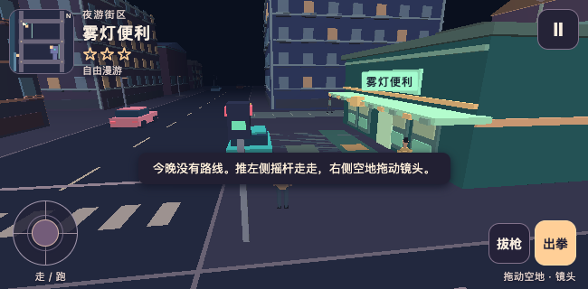

  

<h1 align="center">夜游街区</h1>

  

《夜游街区》是一款为小红书小工具制作的原创离线 3D 沙盒。你可以徒步穿巷、开车绕街、到停车楼顶看夜景，也可以送一单或找找桥下的涂鸦。没有全局倒计时，不接任务也能玩。

游戏使用原生 JavaScript、WebGL 和 Web Audio，不需要安装依赖，也不需要联网；WebGL 不可用时会切到可继续游玩的简图。

## 本地运行

下载或克隆仓库，用浏览器打开 [`app/index.html`](app/index.html)，点击 **开始游戏**。建议用 Chrome 或 Edge。

- **键盘**：`WASD` 或方向键移动／驾驶，`Shift` 跑步，`E` 上下车，`F` 互动，`Esc` 暂停。按住鼠标拖动转镜头，暂停菜单里有完整操作说明。
- **触屏**：横向游玩，左手移动／转向，右手拖镜头和点按操作按钮。

想跑自动测试？用 Node.js 18+ 执行 `node --test tests/*.test.js`。

本地浏览器用于开发试玩，不等同于小红书容器；任务持久化需容器 Storage。打包小工具时只压缩 `app/` 内的文件，确保 `index.html` 位于 ZIP 根目录。

[真机验收路线](docs/playtest.md) · [游戏封面](release-assets/night-district-cover-3x4.png)
